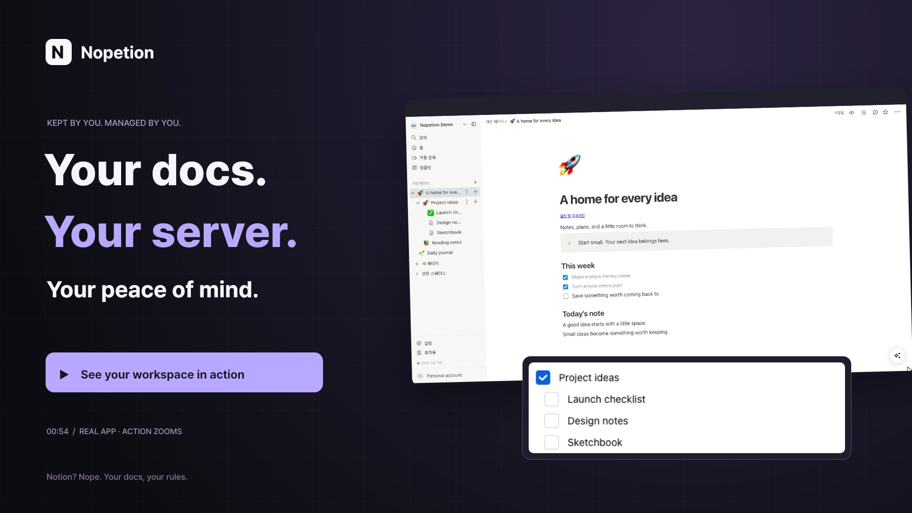

<div align="center">
  
  <h1>Nopetion</h1>
  <p><strong>Notion? Nope. Your docs, your rules.</strong></p>
  <p>A personal document workspace. Hosted by you. Made for your ideas.</p>
  <p>
    <a href="#quick-start">Get started</a> ·
    <a href="docs/readme/assets/nopetion-demo.mp4">Watch the demo</a> ·
    <a href="docs/server-install.md">Installation guide</a>
  </p>
  <p>
    
    
    
  </p>
</div>

<p align="center">
  <strong>English</strong> · <a href="docs/readme/ko-KR.md">한국어</a> · <a href="docs/readme/ja-JP.md">日本語</a> · <a href="docs/readme/zh-CN.md">简体中文</a> · <a href="docs/readme/de-DE.md">Deutsch</a> · <a href="docs/readme/es-ES.md">Español</a> · <a href="docs/readme/fr-FR.md">Français</a> · <a href="docs/readme/it-IT.md">Italiano</a> · <a href="docs/readme/nl-NL.md">Nederlands</a> · <a href="docs/readme/pt-BR.md">Português</a> · <a href="docs/readme/ru-RU.md">Русский</a> · <a href="docs/readme/uk-UA.md">Українська</a>
</p>

[](docs/readme/assets/nopetion-demo.mp4)

<p align="center"><a href="docs/readme/assets/nopetion-demo.mp4">▶ Watch Nopetion in action</a></p>

Write a quick note. Turn it into a project. Keep the whole document tree on your own server. Nopetion brings block editing, personal workspaces and optional document AI together in a self-hosted fork of [Docmost](https://github.com/docmost/docmost).

## A workspace that feels like yours

| Write & organize                                                                                                              | Keep & connect                                                                                                                  |
| :---------------------------------------------------------------------------------------------------------------------------- | :------------------------------------------------------------------------------------------------------------------------------ |
| **✍️ Write in blocks**<br>Build pages with headings, checklists, tables, code, callouts and database views.                   | **💾 Keep your work**<br>Check database save status, revisit page history and restore pages from the trash.                     |
| **🗂️ Organize your way**<br>Nest pages, drag them into order and switch between personal workspaces.                          | **🤖 Connect AI on your terms**<br>Use a separate AI connection, choose the document scope and follow progress from the editor. |
| **😀 Give pages a little personality**<br>Choose from the full emoji catalog, quick suggestions and Korean search aliases.    | **📑 Take your documents with you**<br>Export a page and selected descendants together as a PDF, with Korean font support.      |
| **🏷️ Find a place for every idea**<br>Generate classification tags and lists while keeping your documents where you put them. | **📱 Work across devices**<br>Install the PWA and keep selected pages available for offline editing and later synchronization.  |

Personal mode uses **one owner account** across your workspaces. Public registration, invitations and public sharing are disabled. Attachments stay in local persistent storage.

## Quick start

You need **Docker Compose** and **Node.js 24**. A container-based setup option is available in the [installation guide](docs/server-install.md).

**1. Generate your configuration.**

```sh
node scripts/init-env.mjs
```

**2. Set your address.** Open the generated `.env` and set `APP_URL` to the address you will use in your browser.

```dotenv
APP_URL=http://localhost:3000
```

**3. Start Nopetion.**

```sh
docker compose up --build -d
```

Open your app and enter a **password and confirmation** to create your personal account. After setup, log in with just your password. The generated app secret and database password are separate infrastructure credentials.

Compose binds the app to `127.0.0.1:3000` and keeps PostgreSQL and Redis private. Use an HTTPS reverse proxy or an SSH tunnel to access a remote server. For a subpath such as `/nopetion`, set the full `APP_URL` **before building** and configure the proxy to strip that prefix for HTTP and WebSockets. [Server and Tailscale instructions →](docs/server-install.md)

## Make it your own

- **Account settings:** change your name, password and theme.
- **Server features:** configure Draw.io, optional Gotenberg PDF/A conversion and allowed iframe origins inside the app.
- **AI and connections:** connect providers separately, choose content scope and follow jobs in the document AI panel.
- **PDF:** use the built-in exporter, or optionally configure Gotenberg in server settings.

Email delivery and email-based password recovery are unavailable. Keep your login password somewhere safe.

## Keep your data close

PostgreSQL, Redis, attachments, AI storage and external connector settings use persistent volumes. Back them up together when moving or restoring your server.

- [Install or move a server](docs/server-install.md)
- [Back up and verify a restore](docs/backup-restore.md)
- [Prepare a clean source release](docs/source-release.md)
- [Report a security issue](SECURITY.md)

## Development

One **pnpm/Nx monorepo**: React and Mantine in `apps/client`, NestJS in `apps/server`, shared editor code in `packages`. Use **Node.js 24** and **pnpm 11.28.2**.

```sh
corepack pnpm@11.28.2 install --frozen-lockfile
node scripts/init-env.mjs
docker compose -f docker-compose.dev.yml up -d
pnpm --filter server migration:latest
pnpm dev
```

Run `pnpm build`, `pnpm lint`, `pnpm test` and `pnpm test:personal` for project checks. See [contributing](CONTRIBUTING.md) for more.

## Credits and license

Nopetion is a modified personal fork of **[Docmost 0.96.0](https://github.com/docmost/docmost)**. Thank you to the upstream authors and contributors. The [original README](docs/upstream-readme.md), [source record](docs/upstream-source.json), [modification notice](notices/NOPETION-MODIFICATIONS.md) and [third-party notices](notices) preserve attribution and licensing details.

The core is licensed under **[AGPL-3.0](LICENSE)**. Retained Enterprise license files have separate terms; their removed commercial implementations are not part of the CE source export. The entire original checkout and its history must not be treated as AGPL.

Docker builds include their corresponding application source, available through **Settings → Source and license**. For publication, use the [clean CE source export](docs/source-release.md). Prebuilt images and bundled dependencies require a separate distribution review.
